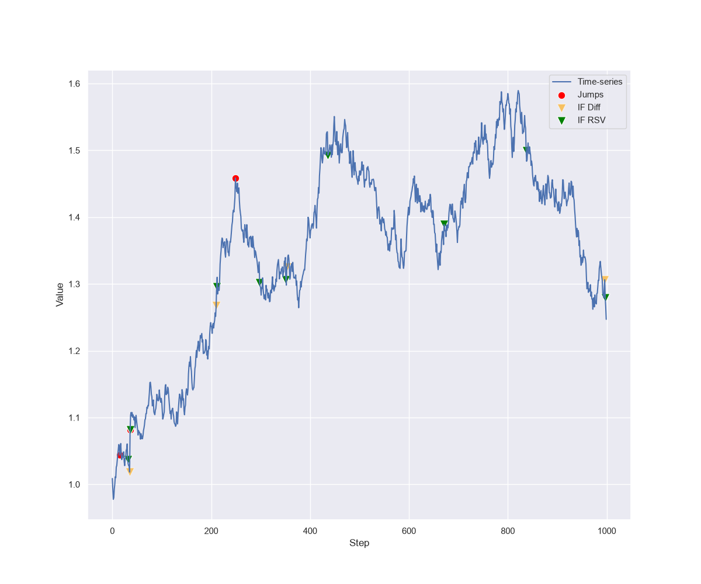
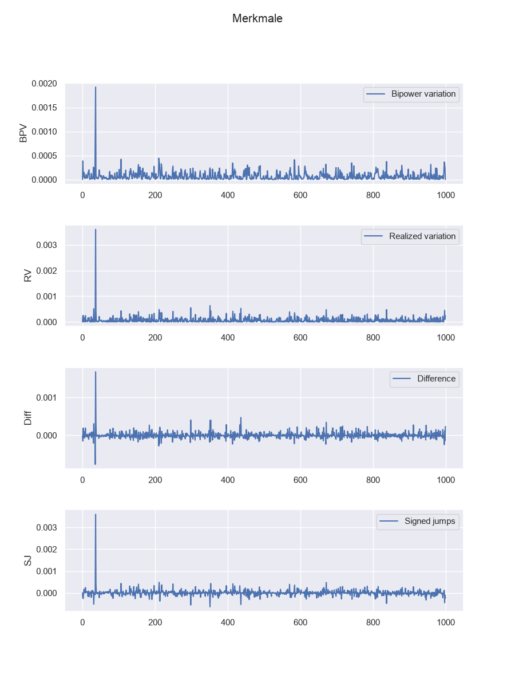
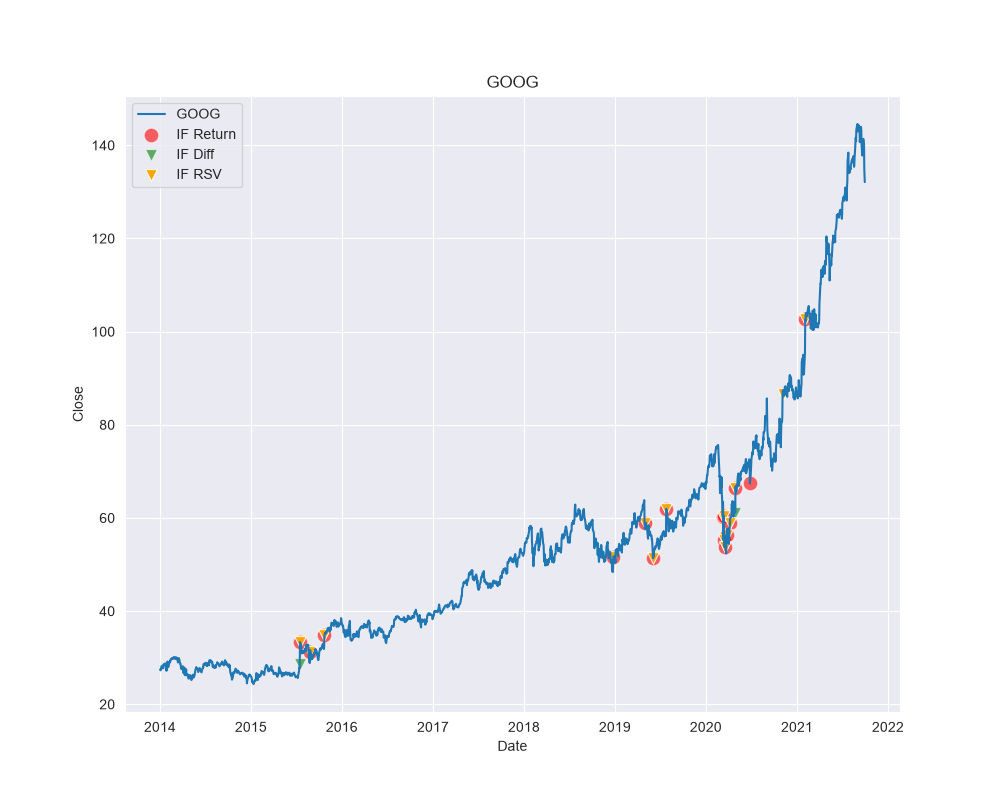

# Anomaly Detection in Financial Market Data

Isolation Forest experiments on synthetic Merton jump-diffusion paths and historical financial market data.



## Overview

This research project investigates whether an [Isolation Forest](https://scikit-learn.org/stable/modules/generated/sklearn.ensemble.IsolationForest.html) can detect abrupt changes in financial time series. It first evaluates the method on synthetic data, where the true jumps are known, and then applies the same feature pipeline to market data downloaded with [yfinance](https://ranaroussi.github.io/yfinance/).

The work is based on concepts from Carl Paulin's 2021 master's thesis, [*Detecting anomalies in data streams driven by a jump-diffusion process*](http://urn.kb.se/resolve?urn=urn:nubn:se:umu:diva-184230).

## Method

The synthetic workflow generates a Merton jump-diffusion process and extracts:

- logarithmic returns
- realized variance (RV)
- realized bipower variation (BPV)
- the difference `RV - BPV`
- realized semi-variation (RSV), represented by signed jumps

Isolation Forest models run on individual and combined features. A threshold-based cutoff method provides a baseline. Because synthetic jumps are known, the notebooks compare detections with F1 scores, classification reports, and confusion matrices.



The market workflow downloads historical close prices, computes the same features, and visualizes the detected anomalies.



## Repository Structure

```text
.
├── src/anomaly_detection/
│   ├── synthetic/          # Merton simulation, feature analysis, evaluation
│   └── market/             # Market loader, feature analysis, plotting
├── notebooks/
│   ├── synthetic/          # Reproducible synthetic-data experiments
│   └── market/             # Network-dependent market-data experiments
├── outputs/figures/
│   ├── synthetic/          # Generated and reference figures
│   └── market/
├── pyproject.toml
├── LICENSE
└── README.md
```

## Requirements

- Python 3.9 or newer
- internet access for the market-data notebooks

Python dependencies are declared in [`pyproject.toml`](pyproject.toml).

## Installation

```bash
git clone https://github.com/Mastercheef/anomaly-detection.git
cd anomaly-detection

python -m venv .venv
source .venv/bin/activate       # Windows: .venv\Scripts\activate
python -m pip install --upgrade pip
python -m pip install -e ".[notebooks]"
```

Run the project from this checkout with the editable installation shown above. It makes `anomaly_detection` importable regardless of the notebook directory and keeps generated figures inside this repository.

## Quick Start

Start Jupyter from the repository root:

```bash
jupyter notebook
```

### Synthetic data

```python
from anomaly_detection.synthetic.analysis import simulation_test, plotter

data = simulation_test(
    v=0.035,
    l=9,
    step=1000,
    sigma=0.25,
    N=1,
    print_f1=True,
)
plotter(data)
```

Generated plots are written to [`outputs/figures/synthetic`](outputs/figures/synthetic).

### Market data

```python
import pandas as pd

from anomaly_detection.market.analysis import build_stock
from anomaly_detection.market.loader import Stocks
from anomaly_detection.market.plotting import plot_signed_anomaly, plotter

tickers = ["META", "AMZN", "AAPL", "NFLX", "GOOG"]
stocks = Stocks(tickers, tickers, start="2014-01-01", stop="2021-10-01")

label = "AAPL"
prices = pd.DataFrame(stocks.df_stocks[label]["Close"])
result = build_stock(prices, N=1, contamin=0.008)

plotter(result, label, features=True)
plot_signed_anomaly(result, label)
```

Generated plots are written to [`outputs/figures/market`](outputs/figures/market). Market downloads depend on the current availability and response format of Yahoo Finance.

## Notebooks

| Notebook | Purpose | External data |
| --- | --- | --- |
| [`synthetic/plot_path.ipynb`](notebooks/synthetic/plot_path.ipynb) | Generate a Merton path and visualize jumps, features, Isolation Forest, and cutoff detections | No |
| [`synthetic/confusion_matrix.ipynb`](notebooks/synthetic/confusion_matrix.ipynb) | Compare Isolation Forest and cutoff classifications | No |
| [`synthetic/simulation.ipynb`](notebooks/synthetic/simulation.ipynb) | Compare repeated runs across six jump rates with the thesis results | No |
| [`market/plot_faang_stocks.ipynb`](notebooks/market/plot_faang_stocks.ipynb) | Detect anomalies in FAANG stocks | Yahoo Finance |
| [`market/plot_futures.ipynb`](notebooks/market/plot_futures.ipynb) | Apply the analysis to futures | Yahoo Finance |
| [`market/stock_prediction.ipynb`](notebooks/market/stock_prediction.ipynb) | Explore historical post-anomaly price direction | Yahoo Finance |
| [`market/stock_simulation.ipynb`](notebooks/market/stock_simulation.ipynb) | Compare contamination settings across market indices | Yahoo Finance |

## Results

The experiments support the usefulness of feature extraction: sharp changes are easier to identify in returns and volatility-derived features than in the raw synthetic path alone. Performance varies by random run, feature, jump rate, and contamination setting. The saved notebooks are historical experiment records, not deterministic benchmarks.

The market notebooks provide qualitative anomaly visualizations. Unlike the synthetic data, market data has no ground-truth jump labels, so those results do not establish predictive performance.

## Reproducibility and Limitations

- Simulations and Isolation Forest models do not currently set fixed random seeds, so results vary between runs.
- Market notebooks require live Yahoo Finance access; historical responses and ticker availability can change.
- Futures can contain non-positive values, for which logarithmic returns are undefined.
- The saved notebook outputs originate from older environments and may display historical warnings.
- The exploratory post-anomaly buying notebooks are not a validated trading strategy.

## Data Sources and References

- Carl Paulin, *Detecting anomalies in data streams driven by a jump-diffusion process*, Umeå University, 2021: [URN record](http://urn.kb.se/resolve?urn=urn:nubn:se:umu:diva-184230)
- scikit-learn: [IsolationForest API](https://scikit-learn.org/stable/modules/generated/sklearn.ensemble.IsolationForest.html)
- yfinance: [documentation](https://ranaroussi.github.io/yfinance/)
- Yahoo: [API terms of use](https://legal.yahoo.com/us/en/yahoo/terms/product-atos/apiforydn/index.html)

`yfinance` is an independent open-source library and is not affiliated with Yahoo. Use downloaded data in accordance with Yahoo's terms.

## Authors

Erik Autenrieth and Pierre Zimmermann — H-BRS data analysis project, December 2021.

## License

Licensed under the [MIT License](LICENSE).

## Disclaimer

This repository is an educational research project. It does not provide financial or investment advice.
